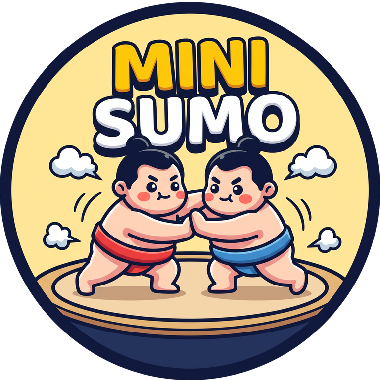
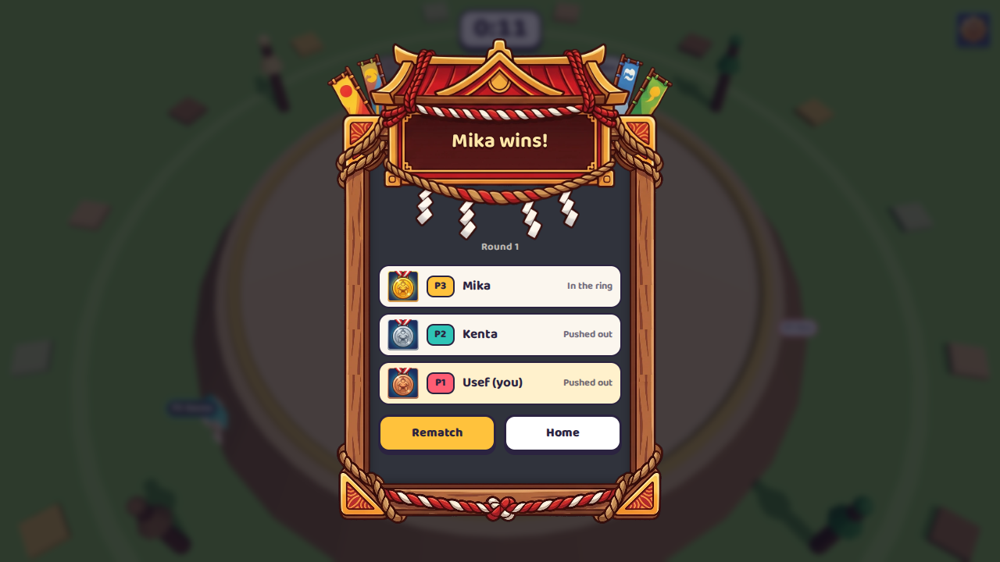
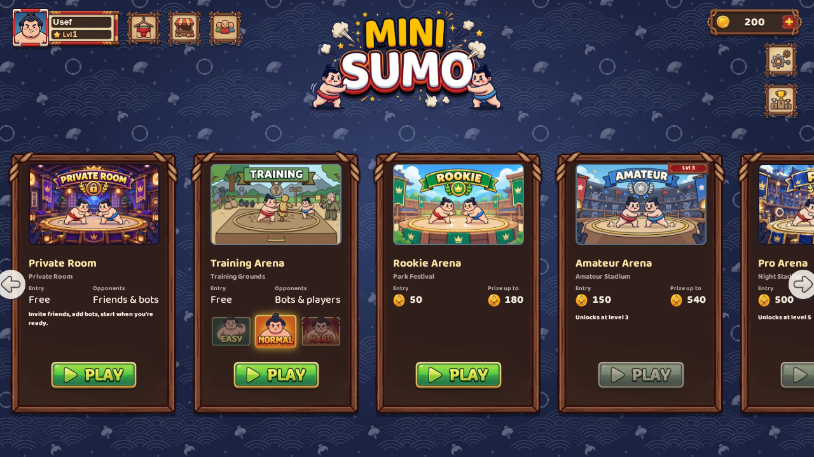
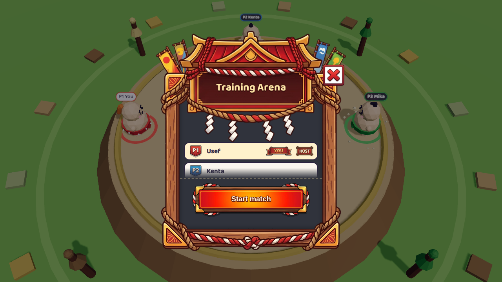
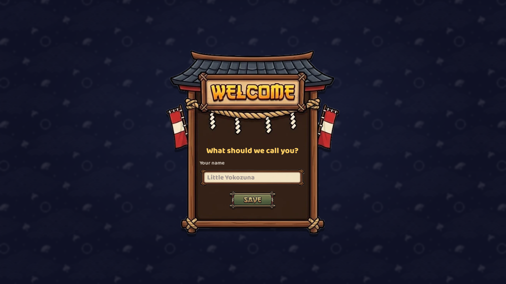
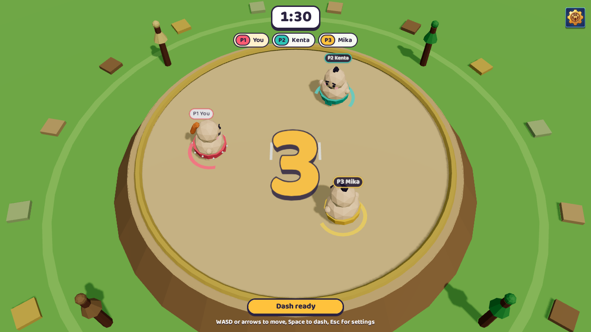
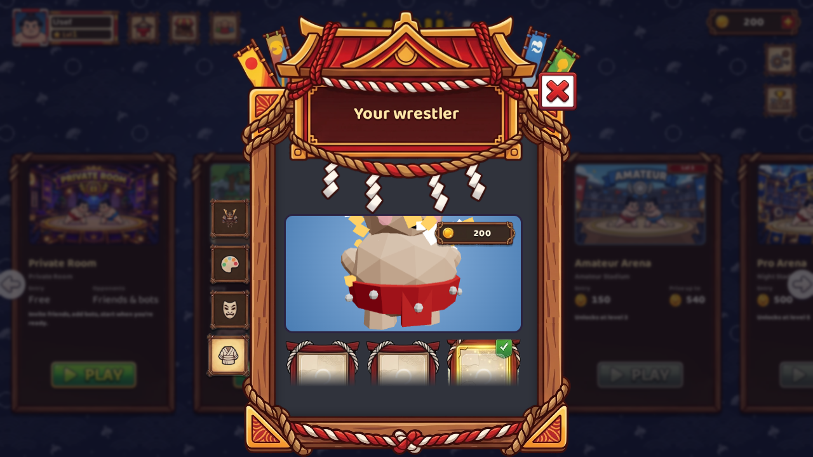
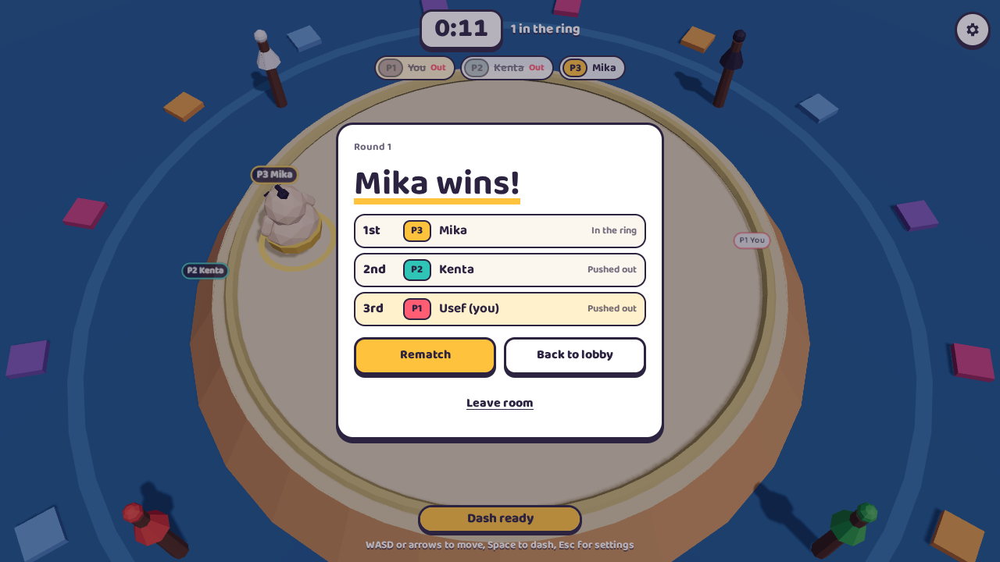
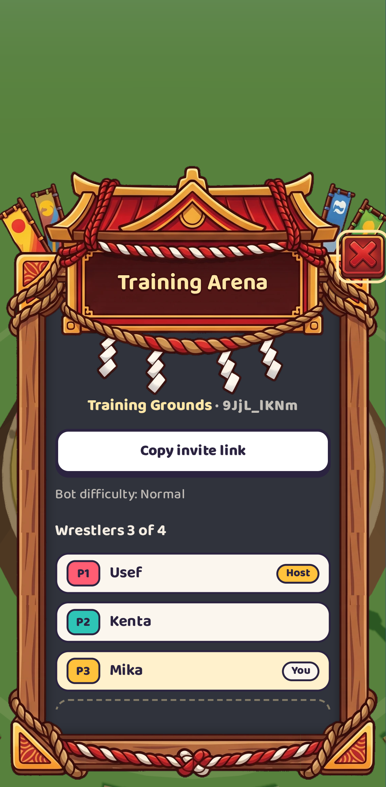
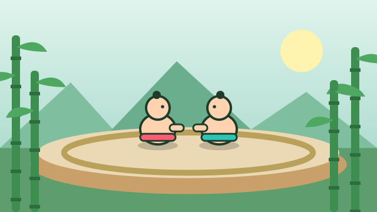

<p align="center">
  
</p>

<h1 align="center">Mini Sumo</h1>

<p align="center"><b>Push your friends out of the ring.</b> A cute 3D multiplayer party game for 2 to 4 players, right in the browser, on your desktop or on Android.</p>

<p align="center">Created by <a href="https://www.useffarahmand.com"><b>Usef Farahmand</b></a></p>

<p align="center">
  <a href="https://github.com/Jolly-Panda-Works/mini-sumo-3d/actions/workflows/build.yml"></a>
  <a href="https://github.com/Jolly-Panda-Works/mini-sumo-3d/releases/latest"></a>
  <a href="https://github.com/Jolly-Panda-Works/mini-sumo-3d/releases"></a>
  <a href="LICENSE"></a>
  
</p>

<p align="center">
  <a href="https://github.com/Jolly-Panda-Works/mini-sumo-3d/releases/latest">Download</a> ·
  <a href="https://www.useffarahmand.com/en/projects/mini-sumo">Game page</a> ·
  <a href="https://github.com/Jolly-Panda-Works/mini-sumo-3d/issues/new?template=bug_report.yml">Report a bug</a> ·
  <a href="https://github.com/Jolly-Panda-Works/mini-sumo-3d/issues/new?template=feature_request.yml">Request a feature</a>
</p>

<p align="center">
  
</p>

> **Server status:** the public game server is not online yet. Until it is, every build runs in **offline practice mode**: rooms are created on your device and you play against bots. Online play switches on by itself once a server is configured (see [Offline mode](#offline-mode)).

---

## Table of contents

- [Why Mini Sumo?](#why-mini-sumo)
- [How to play](#how-to-play)
- [Screenshots](#screenshots)
- [Arenas and coins](#arenas-and-coins)
- [Offline mode](#offline-mode)
- [Download and install](#download-and-install)
- [Run from source](#run-from-source)
- [Build the apps yourself](#build-the-apps-yourself)
- [Releases and versions](#releases-and-versions)
- [Deployment](#deployment)
- [Project structure](#project-structure)
- [Technology](#technology)
- [Limitations](#limitations)
- [Troubleshooting](#troubleshooting)
- [Contributing](#contributing) · [Security](#security) · [Privacy](#privacy) · [License](#license)

## Why Mini Sumo?

Party games are best when everyone understands them in five seconds. Mini Sumo has one rule: **stay in the ring**. Round toy wrestlers bump, bounce and dash into each other on a little dohyo, and the last one standing wins. No accounts, no installs needed for the web version, and a match takes about a minute.

- **Real 3D** with React Three Fiber: squash-and-stretch wrestlers, ring-out falls, dust and shockwaves.
- **Fair multiplayer:** the Colyseus server decides every push, ring-out and winner. Clients only send input.
- **Play anywhere:** browser, Windows, macOS, Linux and Android, with keyboard or touch controls.
- **Invite with a link:** create a private room and share it, or jump into a public quick match.
- **Never wait long:** *Play now* finds an open room or creates one. If nobody shows up within 30 seconds, computer-controlled wrestlers with ordinary names fill the ring and the bout starts.
- **Practice with bots:** the host of a private room can add or remove bots in the lobby.
- **Arenas and Sumo Coins:** earn free coins in the Training Arena, pay a coin entry fee in the Rookie, Pro or Champion arena, and the server pays the winner the pool minus a small economy fee. Spend coins on cosmetics in the wardrobe. Coins are virtual: no real money in, no cash out. See [docs/ECONOMY.md](docs/ECONOMY.md).
- **Make it yours:** pick a hair style and colour, a face and an outfit before the bout. Your belt keeps your player colour and number, so everyone can still tell who is who.

## How to play

| | Step | What happens |
| --- | --- | --- |
| 1 | **Pick a name** | The first launch asks for your name and remembers it. Change it any time on the main menu. |
| | **Dress up** | *Customise wrestler* (main menu or lobby): 5 hair styles, 5 hair colours, 5 faces and 4 outfits, with a live 3D preview. |
| 2 | **Get a room** | *Play now* joins an open public room or creates one; if no one joins within 30 seconds, the room fills up and starts by itself. *Create private room* gives you a code and an invite link for friends. |
| 3 | **Start** | When at least two wrestlers are in, the host presses *Start match* (in a private room the host can also *Add bot*). A synced 3, 2, 1, GO! follows. |
| 4 | **Push** | Run into opponents to shove them. Time your **dash** for a heavy hit, then recover before you slide out yourself. |
| 5 | **Win** | The last wrestler in the ring wins. Then the host picks *Rematch* or *Back to lobby*. |

| Action | Keyboard | Touch |
| --- | --- | --- |
| Move | WASD or arrow keys | Joystick on the left: touch anywhere on the left side and it appears under your thumb (or keep it fixed in the corner) |
| Dash (3 s cooldown) | Space | Big dash button on the right; the ring fills and counts down while it recharges |
| Settings | Esc | Gear button |

On phones and tablets the touch controls appear automatically during a bout (*Settings → Touch controls* can force them on or off). Steering and dashing work at the same time with two thumbs, and supported Android devices vibrate on dashes and hits (*Settings → Vibration*).

*Settings* has your name and avatar, music and sound-effect volumes, controls, *About*, and *Save progress to Google account* (coming soon). The game plays original synthesised music: a calm pentatonic theme on menus and a faster taiko-driven one during bouts. The Android app always runs in landscape.

Settings never pause the shared match. *Settings → About* shows the version, the creator and links to the game page and source code.

<details>
<summary><b>Exact rules</b></summary>

- 2–4 players per room; the host starts once at least 2 are present.
- 3 s countdown (wrestlers are frozen), then a 90 s bout.
- You're out when your centre passes **7.2 m** from the ring centre (ring radius 7 m + 0.2 m tolerance). The straw rope is drawn exactly at 7 m. Only gameplay coordinates count, never the 3D model.
- Within a tick the server runs: movement → collisions → ring-outs → last-standing check → timer check. So a ring-out on the final tick is counted before the timer.
- **Winner:** the last player in the ring.
- **Everyone out in the same tick:** draw; they share first place.
- **Time up with several players in the ring:** the one closest to the centre wins. If the two closest are within 5 cm of each other, it's a draw among all players that close.
- **Standings:** winner (or tied players) first, then players still in the ring by distance to centre, then eliminated players by elimination time (later is better; same tick shares a place).
- After results the host can start a **Rematch** or go **Back to lobby**. Otherwise the room returns to the lobby after 20 s.

Tuning lives in `apps/server/src/simulation/SimulationConfig.ts` (acceleration 28 m/s², max speed 6.5 m/s, drag 4/s, dash 11.5 m/s for 180 ms, cooldown 3 s, dash mass ×2.5, restitution 0.35, push bonus 5).

</details>

## Screenshots

| Main menu | Private room lobby |
| --- | --- |
|  |  |
| **First launch** | **Countdown** |
|  |  |
| **Customise your wrestler** | **Results** |
|  |  |

<p align="center"><br /><i>Touch controls on a phone.</i></p>

Screenshots come from a real three-player match played by the [Screenshots workflow](.github/workflows/screenshots.yml) (*Actions → Screenshots → Run workflow*), which commits fresh images to `docs/screenshots/`.

## Arenas and coins

Every arena has its own look and mood, in the 3D ring and on its card:

| Training Dojo | Festival Street (Rookie) | Moonlit Temple (Pro) | Golden Palace (Champion) |
| --- | --- | --- | --- |
|  |  |  |  |

The home screen shows the paid arenas side by side with entry fee and prize; hovering or focusing a card switches the 3D background to that arena. *Training* (free) has its own button. Features that need the online server show *Coming soon* until it is live.

| Arena | Entry | Winner gets (4 players) | Opponents |
| --- | ---: | ---: | --- |
| Training | free | small free rewards | players, bots fill in |
| Rookie | 100 coins | up to 360 | players only |
| Pro | 500 coins | up to 1,800 | players only, unlocks after 10 bouts |
| Champion | 2,000 coins | up to 7,200 | players only, unlocks after 20 bouts and 10 wins |

- New players get 500 coins. Training pays +5 per finished bout, +15 for a win and +50 for the first bout of the day, up to 300 per day.
- Prize = pool − 10 % economy fee (integer, `floor`). Draws and bouts that never start are refunded; leaving during a bout is a loss.
- The **wardrobe is the shop**: priced options can be tried on and bought with coins. Looks never affect gameplay.
- Everything (balances, prices, entries, prizes, ownership) is decided by the server and recorded in an append-only ledger with idempotency keys. *Settings* never stores coins.
- Accounts are device-bound guest accounts for now; coins don't sync between devices.
- Real-money purchases and premium currency are **disabled**; the payment boundary is prepared but no provider is selected.

Full rules, ledger model, refund policy, API and configuration: [docs/ECONOMY.md](docs/ECONOMY.md). The economy needs the online server; offline builds keep the free Training Arena.

## Offline mode

Mini Sumo runs the **same authoritative game session** the server uses directly in your browser or app when no server is available. Rooms are then local and your opponents are bots with ordinary names, so the game is fully playable before (or without) a server.

| Situation | What happens |
| --- | --- |
| Build without `VITE_SERVER_URL` (current releases, GitHub Pages) | Offline from the start. |
| `VITE_SERVER_URL` set, server reachable | Online: real rooms, invite links, quick match with other players. |
| Server set but unreachable (down, no internet) | Falls back to offline when you press *Play now* or create a room. |

Offline, *Play now* searches for a few seconds and fills the ring with bots; *Create room with bots* opens a lobby where you add bots yourself. Joining friends by code needs the online server. Force a mode with `VITE_NETWORK_MODE=online|offline|auto` (default `auto`). *Settings → About* shows the current mode.

## Download and install

1. Open the [**latest release**](https://github.com/Jolly-Panda-Works/mini-sumo-3d/releases/latest).
2. Download the file for your device:

| Platform | File |
| --- | --- |
| Windows | `MiniSumo-<version>-Windows-Setup.exe` (installer) or `…-Windows-Portable.exe` |
| macOS | `MiniSumo-<version>-macOS-arm64.dmg` (Apple Silicon) or `…-macOS-x64.dmg` (Intel) |
| Linux | `MiniSumo-<version>-Linux-x86_64.AppImage` or `…-Linux-amd64.deb` |
| Android | `MiniSumo-<version>-Android.apk` |
| Web | `MiniSumo-<version>-Web.zip` (static site for your own hosting) |

> **Warning on first launch?** The apps aren't code-signed yet. On Windows click **More info → Run anyway**; on macOS right-click the app and choose **Open**. Every release ships `SHA256SUMS.txt` so you can verify the download. Details: [CODE_SIGNING.md](CODE_SIGNING.md).

## Run from source

Requirements: **Node.js 22.13+** (the server uses the built-in `node:sqlite`) and npm 10+.

```bash
git clone https://github.com/Jolly-Panda-Works/mini-sumo-3d.git
cd mini-sumo-3d
npm install
npm run dev
```

- Game: <http://localhost:5173> (Vite also prints your LAN address, so phones on the same Wi-Fi can join)
- Server: `ws://localhost:2567`, health check at <http://localhost:2567/health>

Open two tabs, create a private room in one and paste the invite link into the other.

| Command | What it does |
| --- | --- |
| `npm run dev` | Shared package (watch), server and client together |
| `npm test` | 83 server tests: movement, collisions, ring-outs, dash, bots, quick match, match lifecycle, lobby and disconnects |
| `npm run typecheck` | TypeScript checks for server and client |
| `npm run build` | Production build of shared, server and web client |
| `npm start` | Start the built server |
| `npm run desktop` | Build the web client and launch the desktop app |

### Configuration

One `.env` at the repository root (copy `.env.example`) serves both apps. Only `VITE_*` variables reach the browser, and they are baked in at build time.

One `.env` file at the repository root serves both apps. Only variables prefixed with `VITE_` are exposed to the browser, and they are baked in at build time, so never put secrets there.

| Variable | Used by | Default | Purpose |
| --- | --- | --- | --- |
| `PORT` | server | `2567` | HTTP + WebSocket port |
| `HOST` | server | `0.0.0.0` | Bind address (`0.0.0.0` lets phones on your LAN connect) |
| `VITE_SERVER_URL` | client (build time) | empty | Public WebSocket endpoint, e.g. `wss://sumo-api.example.com`. **Set this in production.** |
| `VITE_SERVER_PORT` | client (build time) | `2567` | Port for the fallback URL when `VITE_SERVER_URL` is empty |
| `VITE_PUBLIC_URL` | client (build time) | empty | Public web address for invite links (needed by desktop/Android builds) |
| `VITE_BASE` | client (build time) | `/` | Base path, e.g. `/<repo>/` for GitHub Pages |

If `VITE_SERVER_URL` is empty, the client connects to `ws(s)://<page hostname>:<VITE_SERVER_PORT>`. That makes local and LAN development work with no configuration and never hard-codes `localhost`.

## Build the apps yourself

**GitHub Actions (recommended).** Every push to `main` builds the web, desktop and Android versions and publishes them as a GitHub Release. See [Releases and versions](#releases-and-versions).

**Locally:**

```bash
npm run build:desktop    # installer/app for your current OS in apps/desktop/release/
npm run android:install && cd apps/mobile && npx cap add android && cd ../..   # once; needs Android SDK + JDK 21
npm run build:android    # then: npm run android:open --prefix apps/mobile
```

`apps/desktop` (Electron) and `apps/mobile` (Capacitor) aren't npm workspaces, so a plain `npm install` never downloads Electron or the Android tooling.

<details>
<summary><b>CI settings (variables and secrets)</b></summary>

Configure under *Settings → Secrets and variables → Actions*:

| Name | Kind | Purpose |
| --- | --- | --- |
| `VITE_SERVER_URL` | variable | Public server, e.g. `wss://sumo-api.example.com`. Android requires `wss://`. Until it's set, releases carry a "server not live" warning. |
| `VITE_PUBLIC_URL` | variable | Web address used in invite links from the apps. Defaults to `https://<owner>.github.io/<repo>/`. |
| `DEPLOY_PAGES` | variable | `true` to publish the web build to GitHub Pages from `main` (also set *Settings → Pages → Source: GitHub Actions*). |
| `ANDROID_KEYSTORE_BASE64` | secret | `base64 -w0 release.keystore`, for a signed APK/AAB |
| `ANDROID_KEYSTORE_PASSWORD`, `ANDROID_KEY_ALIAS`, `ANDROID_KEY_PASSWORD` | secrets | Keystore credentials |

</details>

## Releases and versions

The release line lives in the root `package.json` `version` (currently `0.1.0`). The [Build workflow](.github/workflows/build.yml) decides the final version and injects the same string into the web client (*Settings → About*), the desktop apps, the Android `versionName` and the release name:

| Trigger | Version | Published? |
| --- | --- | --- |
| Tag `vX.Y.Z` | `X.Y.Z` exactly | Yes, release `vX.Y.Z` |
| Push to `main` | `MAJOR.MINOR.<build number>`, e.g. `0.1.42` | Yes, tag `v0.1.42` is created |
| Pull requests and other branches | `MAJOR.MINOR.0-dev.<build number>` | No, artifacts only |

Each release contains the Windows, macOS, Linux, Android and web files plus `SHA256SUMS.txt`. To start a new line (e.g. `0.2.x`), change the root `version` and push. Android's `versionCode` is the workflow run number, so it always increases.

## Deployment

The client is a static site; the server needs a long-running Node.js process with WebSocket support. Static hosting cannot run the server.

### 1. Server (any Node host: a VPS, Render, Railway, Fly.io, Colyseus Cloud…)

```bash
npm ci
npm run build:shared
npm run build -w @mini-sumo/server
PORT=2567 npm start
```

Put it behind HTTPS so browsers can use `wss://`. Example nginx block:

```nginx
server {
  listen 443 ssl;
  server_name sumo-api.example.com;
  # ssl_certificate ...; ssl_certificate_key ...;
  location / {
    proxy_pass http://127.0.0.1:2567;
    proxy_http_version 1.1;
    proxy_set_header Upgrade $http_upgrade;
    proxy_set_header Connection "upgrade";
    proxy_set_header Host $host;
    proxy_read_timeout 3600s;
  }
}
```

Colyseus uses HTTP for matchmaking (`/matchmake/*`, CORS handled by Colyseus) and WebSockets for the room, both on the same port. Run **one** server process: rooms live in memory, so multiple instances need Colyseus presence/driver (Redis), which this MVP does not configure.

### 2. Client (Netlify, Vercel, Cloudflare Pages, GitHub Pages, S3…)

```bash
VITE_SERVER_URL=wss://sumo-api.example.com npm run build
# upload apps/client/dist/
```

`VITE_SERVER_URL` is read at build time; rebuild when it changes. Pages served over `https://` must use a `wss://` server URL.

A standalone copy of the server with a step-by-step Ubuntu guide (Node.js, PM2, nginx, certbot) is available as **mini-sumo-server**; the same steps work for `apps/server` in this repository.

## Project structure

```
mini-sumo-3d/
├── apps/
│   ├── client/          # React + React Three Fiber web client (Vite)
│   ├── server/          # Colyseus room, game session, simulation, tests
│   ├── desktop/         # Electron shell + packaging script (electron-builder)
│   └── mobile/          # Capacitor config and Android icon/splash sources
├── packages/shared/     # message names, constants, synced state types, credits
├── tools/               # release notes and screenshot automation
├── docs/                # architecture notes, screenshots, social preview, Persian guide
├── .github/             # CI, release and screenshot workflows, issue & PR templates
├── CHANGELOG.md · CODE_SIGNING.md · CONTRIBUTING.md · SECURITY.md · PRIVACY.md
└── LICENSE
```

How the server, client and networking fit together, the synced state, the room lifecycle and the disconnect rules: [docs/ARCHITECTURE.md](docs/ARCHITECTURE.md).

## Technology

| Area | Stack |
| --- | --- |
| Client | React 19, React Three Fiber 9, three.js, Vite 6, TypeScript |
| Server | Colyseus 0.16, @colyseus/schema 3, Node.js 22, TypeScript |
| Desktop | Electron 37, electron-builder 26 |
| Android | Capacitor 7 |
| Tests and CI | Vitest, GitHub Actions, Playwright (screenshots) |

## Limitations

- No reconnection: a dropped connection ends your participation in the room.
- No client-side prediction; on high-latency links your own movement feels delayed.
- Single server instance; no horizontal scaling configuration.
- No ready-check, spectator joining, accounts, or persistent stats.
- Room codes are the Colyseus room ids (about 9 case-sensitive characters). Privacy means "not listed"; anyone with the code can join. It is not an authorization mechanism.
- No automated Colyseus integration tests (`@colyseus/testing`); room logic is tested through `GameSession`, which the room delegates to.
- Name tags use a canvas texture; they redraw once the web font loads, and fall back to system rounded fonts offline.
- Google Fonts is loaded from the network; the game works without it using fallback fonts.
- Colyseus 0.16 is used deliberately (stable, well known APIs). Newer 0.17/0.18 releases rename the client SDK (`@colyseus/sdk`) and change server bootstrapping; upgrade following the official migration guides.
- The public server isn't live yet; online play needs your own server for now.
- Desktop and Android builds aren't code-signed ([CODE_SIGNING.md](CODE_SIGNING.md)).

## Troubleshooting

- **"Can't reach the game server at …"**: the server is not running, the port is blocked, or `VITE_SERVER_URL` is wrong. Open `http(s)://<server>/health`; it should return `{"ok":true}`.
- **Works on desktop, not on phone (LAN):** open the client using your computer's LAN IP (Vite prints it), make sure the server binds `HOST=0.0.0.0`, and allow port 2567 in the firewall.
- **Mixed content / WebSocket blocked in production:** an `https` page cannot open `ws://`. Use `wss://` behind TLS.
- **"That room doesn't exist anymore":** rooms are disposed once empty, and codes are case-sensitive. Use the invite link.
- **"That room is full or a match is already running":** wait for the round to end, or create a new room.
- **`'tsc' is not recognized`:** dependencies are not installed (or `npm install` failed). Run `npm install` at the repository root first.
- **Electron download fails (`ECONNRESET` in `node_modules/electron`):** GitHub downloads are blocked or unstable on your network. Retry with a mirror: `set ELECTRON_MIRROR=https://npmmirror.com/mirrors/electron/` (cmd) or `$env:ELECTRON_MIRROR="https://npmmirror.com/mirrors/electron/"` (PowerShell), then `npm run desktop:install`.
- **`EPERM: operation not permitted, rmdir` on Windows:** another program locks `node_modules` (VS Code, antivirus, OneDrive sync, a running dev server). Close it, delete `node_modules` (`rmdir /s /q node_modules`) and install again.
- **`process.loadEnvFile is not a function`:** upgrade to Node.js 20.12+.
- **Decorator or schema errors on the server:** `experimentalDecorators: true` and `useDefineForClassFields: false` must stay in `apps/server/tsconfig.json`.

## Contributing

Contributions are very welcome! Please read [CONTRIBUTING.md](CONTRIBUTING.md) and follow the [Code of Conduct](CODE_OF_CONDUCT.md). A good first step: play a match and [open an issue](https://github.com/Jolly-Panda-Works/mini-sumo-3d/issues/new/choose).

## Security

Found a vulnerability? Please don't open a public issue. See [SECURITY.md](SECURITY.md).

## Privacy

No accounts, analytics or ads. What little the game stores is described in [PRIVACY.md](PRIVACY.md).

## License

Released under the [MIT License](LICENSE) © 2026 [Usef Farahmand](https://github.com/Usef-Farahmand) · [useffarahmand.com](https://www.useffarahmand.com) · [Game page](https://www.useffarahmand.com/en/projects/mini-sumo)

## Acknowledgments

[React Three Fiber](https://r3f.docs.pmnd.rs/) · [three.js](https://threejs.org/) · [Colyseus](https://colyseus.io/) · [Vite](https://vite.dev/) · [Electron](https://www.electronjs.org/) · [electron-builder](https://www.electron.build/) · [Capacitor](https://capacitorjs.com/) · [Vitest](https://vitest.dev/) · [Playwright](https://playwright.dev/) · [Baloo 2](https://fonts.google.com/specimen/Baloo+2)
