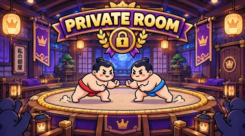
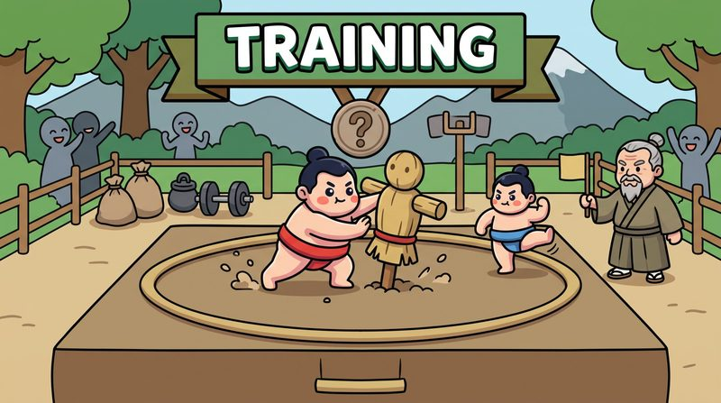
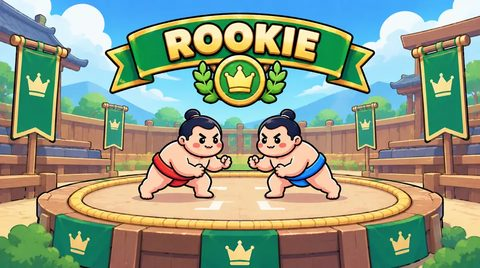
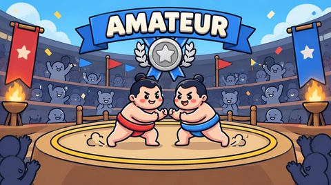
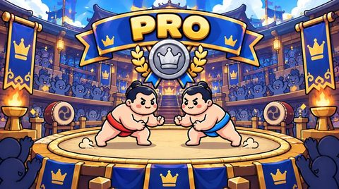
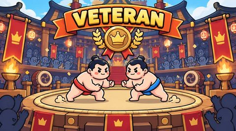
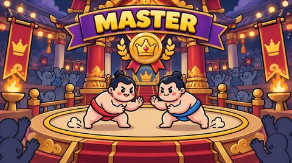

<p align="center">
  
</p>

<h1 align="center">Mini Sumo</h1>

<p align="center"><b>Push your friends out of the ring.</b> A cute 3D multiplayer party game for 2 to 4 players, right in the browser, on your desktop or on Android.</p>

<p align="center">Created by <a href="https://www.useffarahmand.com"><b>Usef Farahmand</b></a></p>

<p align="center">
  <a href="https://github.com/Jolly-Panda-Works/mini-sumo-3d/actions/workflows/build.yml"></a>
  <a href="https://github.com/Jolly-Panda-Works/mini-sumo-3d/releases/latest"></a>
  <a href="https://github.com/Jolly-Panda-Works/mini-sumo-3d/releases"></a>
  <a href="LICENSE"></a>
  
</p>

<p align="center">
  <a href="https://github.com/Jolly-Panda-Works/mini-sumo-3d/releases/latest">Download</a> ·
  <a href="https://www.useffarahmand.com/en/projects/mini-sumo">Game page</a> ·
  <a href="https://github.com/Jolly-Panda-Works/mini-sumo-3d/issues/new?template=bug_report.yml">Report a bug</a> ·
  <a href="https://github.com/Jolly-Panda-Works/mini-sumo-3d/issues/new?template=feature_request.yml">Request a feature</a>
</p>

<p align="center">
  
</p>

> **Server status:** the public game server is not online yet. Until it is, every build runs in **offline practice mode**: rooms are created on your device and you play against bots. Online play switches on by itself once a server is configured (see [Offline mode](#offline-mode)).

---

## Table of contents

- [Why Mini Sumo?](#why-mini-sumo)
- [How to play](#how-to-play)
- [Screenshots](#screenshots)
- [Arenas and coins](#arenas-and-coins)
- [Offline mode](#offline-mode)
- [Download and install](#download-and-install)
- [Run from source](#run-from-source)
- [Build the apps yourself](#build-the-apps-yourself)
- [Releases and versions](#releases-and-versions)
- [Deployment](#deployment)
- [Project structure](#project-structure)
- [Technology](#technology)
- [Limitations](#limitations)
- [Troubleshooting](#troubleshooting)
- [Contributing](#contributing) · [Security](#security) · [Privacy](#privacy) · [License](#license)

## Why Mini Sumo?

Party games are best when everyone understands them in five seconds. Mini Sumo has one rule: **stay in the ring**. Round toy wrestlers bump, bounce and dash into each other on a little dohyo, and the last one standing wins. No accounts, no installs needed for the web version, and a match takes about a minute.

- **Real 3D** with React Three Fiber: squash-and-stretch wrestlers, ring-out falls, dust and shockwaves.
- **Fair multiplayer:** the Colyseus server decides every push, ring-out and winner. Clients only send input.
- **Play on Android** (and in the browser for testing), with touch or keyboard controls.
- **Friends:** add friends with a friend code or straight from a bout's results, see who's online, in a lobby or in a match, and invite them into your room (private rooms also have an invite link). Tap anyone on the **leaderboard** to see their profile.
- **Never wait long:** every arena finds an open room or creates one. If nobody shows up within 10 seconds, computer-controlled wrestlers fill the ring and the bout starts.
- **Bots with styles:** three levels (Easy, Normal, Hard); bots press, circle and charge in from a distance, each with its own temper. The host of a private room or Training can add random players with + in an empty seat.
- **Power-ups:** every 8–12 s a nobori flag pops up on the ring; grab it for 12 s of *Iron Body* (鉄, twice as heavy), *Thunder Dash* (雷, dash recharges in 0.8 s), *Wind Feet* (風, 40 % faster) or *Giant* (巨, bigger and heavier). The flag then rides on your back until it runs out. Bots wait their turn before going for a flag (hard after 1.5 s, normal 3 s, easy 4.5 s), and no new flags appear in the final 30 seconds.
- **Comeback balance:** in the last 30 seconds of a bout every player's dash recharges faster (down to about half the cooldown) and bots ease off a little, so endings stay exciting.
- **Ten arenas and Sumo Coins:** a private room, free Training, then Rookie, Amateur, Pro, Veteran, Champion, Master, Legend and Godlike, each with a bigger entry fee, prize and XP. The server pays the winner the pool minus a small economy fee. Free daily coins in the shop; coin packs are sold through Cafe Bazaar (verified by the server). See [docs/ECONOMY.md](docs/ECONOMY.md).
- **Make it yours:** hairstyles and hats, hair colours, faces and masks, outfits, and 40 profile pictures, in four rarity tiers (common, rare, epic, legendary). Your belt keeps your player colour and number, so everyone can still tell who is who.

## How to play

| | Step | What happens |
| --- | --- | --- |
| 1 | **Pick a name** | The first launch asks for your name and remembers it. Change it any time on the main menu. |
| | **Dress up** | *Customise* (hanger button on the home screen or in the lobby): tabs for hair (9), hair colour (10), face (9) and outfit (8), with a live 3D preview. Every item has a price; bought items are yours for good and are listed first. |
| 2 | **Get a room** | *Play now* joins an open public room or creates one; if no one joins within 30 seconds, the room fills up and starts by itself. *Create private room* gives you a code and an invite link for friends. |
| 3 | **Start** | When at least two wrestlers are in, the host presses *Start match* (in a private room the host can also *Add bot*). A synced 3, 2, 1, GO! follows. |
| 4 | **Push** | Run into opponents to shove them. Time your **dash** for a heavy hit, then recover before you slide out yourself. |
| 5 | **Win** | The last wrestler in the ring wins. Then the host picks *Rematch* or *Back to lobby*. |

| Action | Keyboard | Touch |
| --- | --- | --- |
| Move | WASD or arrow keys | Joystick on the left: touch anywhere on the left side and it appears under your thumb (or keep it fixed in the corner) |
| Dash (3 s cooldown) | Space | Big dash button on the right; the ring fills and counts down while it recharges |
| Settings | Esc | Gear button |

On phones and tablets the touch controls appear automatically during a bout (*Settings → Touch controls* can force them on or off). Steering and dashing work at the same time with two thumbs, and supported Android devices vibrate on dashes and hits (*Settings → Vibration*).

*Settings* has music and sound-effect volumes, controls and *About* (with the version); during a match it also has *Leave match*. Your name, level and stats live in *Profile*. Music: a Japanese bamboo-flute loop on the home screen, lobby and results, and a taiko percussion loop during bouts, crossfaded smoothly when you switch; it pauses while the app is in the background. The Android app always runs in portrait.

Settings never pause the shared match. *Settings → About* shows the version, the creator and links to the game page and source code.

<details>
<summary><b>Exact rules</b></summary>

- 2–4 players per room; the host starts once at least 2 are present.
- 3 s countdown (wrestlers are frozen), then a 90 s bout.
- You're out when your centre passes **7.2 m** from the ring centre (ring radius 7 m + 0.2 m tolerance). The straw rope is drawn exactly at 7 m. Only gameplay coordinates count, never the 3D model.
- Within a tick the server runs: movement → collisions → ring-outs → last-standing check → timer check. So a ring-out on the final tick is counted before the timer.
- **Winner:** the last player in the ring.
- **Everyone out in the same tick:** draw; they share first place.
- **Time up with several players in the ring:** the one closest to the centre wins. If the two closest are within 5 cm of each other, it's a draw among all players that close.
- **Standings:** winner (or tied players) first, then players still in the ring by distance to centre, then eliminated players by elimination time (later is better; same tick shares a place).
- After results the host can start a **Rematch** or go **Back to lobby**. Otherwise the room returns to the lobby after 20 s.

Tuning lives in `apps/server/src/simulation/SimulationConfig.ts` (acceleration 28 m/s², max speed 6.5 m/s, drag 4/s, dash 11.5 m/s for 180 ms, cooldown 3 s, dash mass ×2.5, restitution 0.35, push bonus 5).

</details>

## Screenshots

| Home | Waiting room |
| --- | --- |
|  |  |
| **Customise your wrestler** | **Countdown** |
|  |  |
| **Bout** | **Results** |
|  |  |

**On a phone**

| Home | Bout | Leaderboard | Friends | Coin shop |
| --- | --- | --- | --- | --- |
|  |  |  |  |  |

**[Every screen and popup, on a phone and a desktop →](docs/SCREENSHOTS.md)**

The [Screenshots workflow](.github/workflows/screenshots.yml) (*Actions → Screenshots → Run workflow*) plays a real three-player match, then opens every screen and popup through dev mode (sample data) on a phone and a desktop screen, and commits the images to `docs/screenshots/` together with the gallery page [docs/SCREENSHOTS.md](docs/SCREENSHOTS.md). To run it yourself: build the game, start the server and `npm run preview -w @mini-sumo/client`, then `node tools/screenshots.mjs`.

## Arenas and coins

Every arena has its own artwork, colours and mood, in the 3D ring and on its card:

| Private Room | Training | Rookie | Amateur | Pro |
| --- | --- | --- | --- | --- |
|  |  |  |  |  |
| **Veteran** | **Champion** | **Master** | **Legend** | **Godlike** |
|  |  |  |  |  |

The home screen has its own night-stage backdrop with the title in the middle and the arenas side by side (artwork, entry fee, prize, unlock level); the Private Room and the free Training Arena come first, and on phones the arenas are a swipeable carousel. Each arena's 3D environment appears only once you're in a room. Online features (friends, the leaderboard, paid arenas against people, coin packs) need the game server; without a connection the game plays against bots on the device and syncs your progress later.

| Arena | Entry | Winner gets (4 players) | Unlocks | XP |
| --- | ---: | ---: | --- | ---: |
| Private Room | free | XP only | – | ×1 |
| Training | free | XP only | – | ×1 |
| Rookie | 50 | up to 180 | level 1 | ×1.5 |
| Amateur | 150 | up to 540 | level 3 | ×1.75 |
| Pro | 500 | up to 1,800 | level 5 | ×2 |
| Veteran | 1,000 | up to 3,600 | level 8 | ×2.5 |
| Champion | 2,000 | up to 7,200 | level 10 | ×3 |
| Master | 5,000 | up to 18,000 | level 15 | ×4 |
| Legend | 10,000 | up to 36,000 | level 20 | ×5 |
| Godlike | 25,000 | up to 90,000 | level 30 | ×6 |

- New players get 200 coins (enough for a first Rookie bout) and level up with XP from every bout (up to level 1000); higher arenas unlock as you level up and give more XP. The *Profile* panel shows level, XP, stats and unlocks.
- Online, coins, XP and items live on the server (and sync across devices); offline, the game keeps them on the device and syncs when it's back online.
- Training is free practice: no coins, but every finished bout earns XP.
- Prize = pool − 10 % economy fee (integer, `floor`). Draws and bouts that never start are refunded; leaving during a bout is a loss.
- The **wardrobe is the shop**: priced options can be tried on and bought with coins. Looks never affect gameplay.
- Everything (balances, prices, entries, prizes, ownership) is decided by the server and recorded in an append-only ledger with idempotency keys. *Settings* never stores coins.
- Accounts are device-bound guest accounts for now; coins don't sync between devices.
- Real-money purchases and premium currency are **disabled**; the payment boundary is prepared but no provider is selected.

Full rules, ledger model, refund policy, API and configuration: [docs/ECONOMY.md](docs/ECONOMY.md). The economy needs the online server; offline builds keep the free Training Arena.

## Offline mode

Mini Sumo runs the **same authoritative game session** the server uses directly in your browser or app when no server is available. Rooms are then local and your opponents are bots with ordinary names, so the game is fully playable before (or without) a server.

| Situation | What happens |
| --- | --- |
| Build without a server address (`VITE_NETWORK_MODE=offline`, e.g. the media build) | Offline from the start. |
| `VITE_SERVER_URL` set, server reachable | Online: real rooms, invite links, quick match with other players. |
| Server set but unreachable (down, no internet) | Falls back to offline when you press *Play now* or create a room. |

Offline, *Play now* searches for a few seconds and fills the ring with bots; *Create room with bots* opens a lobby where you add bots yourself. Joining friends by code needs the online server. Force a mode with `VITE_NETWORK_MODE=online|offline|auto` (default `auto`). *Settings → About* shows the current mode.

## Download and install

- **Android:** open the [**latest release**](https://github.com/Jolly-Panda-Works/mini-sumo-3d/releases/latest) and install `MiniSumo-<version>-Android.apk` (signed; the `.aab` is for Google Play). Every release ships `SHA256SUMS.txt` to verify the download.
- **Web:** play at [sumo.ryujin.fans](https://sumo.ryujin.fans/) or on [GitHub Pages](https://jolly-panda-works.github.io/mini-sumo-3d/) (updated on every push to `main`), or host it yourself: every Release has `MiniSumo-X.Y.Z-Web.zip`, the whole game for the browser (WebGL). Unzip it onto any HTTPS web host, in any folder; `HOSTING.txt` inside explains caching and gives an nginx example.

- **Desktop:** every Release also has the desktop app: `MiniSumo-X.Y.Z-Windows-Setup.exe` (installer), `MiniSumo-X.Y.Z-Windows-Portable.exe` (no install), and `MiniSumo-X.Y.Z-Linux-x86_64.AppImage` / `-Linux-amd64.deb`. They aren't code-signed, so Windows asks once ("More info" → "Run anyway"). The desktop app plays with the keyboard (WASD or arrows, Space to dash, Esc for settings, H for Home, Enter for Rematch).

**Game server:** `https://sumo.ryujin.fans` (web game, API and websockets on one address). Android, Cafe Bazaar and web builds connect to `wss://sumo.ryujin.fans` by default; the repository variables `VITE_SERVER_URL` / `VITE_PUBLIC_URL` override it. `npm run dev` still uses a local server.

**Self-hosting (Docker):** `docker compose up -d --build` runs the game server and the web game on one port; it builds in Iran through registry and npm mirrors. See [docker/README.md](docker/README.md).

**Cafe Bazaar:** the `bazaar` branch builds the Bazaar version (coin packs through Bazaar in-app billing, no Google Play Games) and publishes `bazaar-vX.Y.Z` releases. See [docs/BAZAAR.fa.md](docs/BAZAAR.fa.md).

## Run from source

Requirements: **Node.js 22.13+** (the server uses the built-in `node:sqlite`) and npm 10+.

```bash
git clone https://github.com/Jolly-Panda-Works/mini-sumo-3d.git
cd mini-sumo-3d
npm install
npm run dev
```

- Game: <http://localhost:5173> (Vite also prints your LAN address, so phones on the same Wi-Fi can join)
- Server: `ws://localhost:2567`, health check at <http://localhost:2567/health>

Open two tabs, create a private room in one and paste the invite link into the other.

| Command | What it does |
| --- | --- |
| `npm run dev` | Shared package (watch), server and client together |
| `npm test` | 83 server tests: movement, collisions, ring-outs, dash, bots, quick match, match lifecycle, lobby and disconnects |
| `npm run typecheck` | TypeScript checks for server and client |
| `npm run build` | Production build of shared, server and web client |
| `npm start` | Start the built server |
| `npm run desktop` | Build the web client and launch the desktop app |

### Configuration

One `.env` at the repository root (copy `.env.example`) serves both apps. Only `VITE_*` variables reach the browser, and they are baked in at build time.

One `.env` file at the repository root serves both apps. Only variables prefixed with `VITE_` are exposed to the browser, and they are baked in at build time, so never put secrets there.

| Variable | Used by | Default | Purpose |
| --- | --- | --- | --- |
| `PORT` | server | `2567` | HTTP + WebSocket port |
| `HOST` | server | `0.0.0.0` | Bind address (`0.0.0.0` lets phones on your LAN connect) |
| `VITE_SERVER_URL` | client (build time) | empty | Public WebSocket endpoint, e.g. `wss://sumo-api.example.com`. **Set this in production.** |
| `VITE_SERVER_PORT` | client (build time) | `2567` | Port for the fallback URL when `VITE_SERVER_URL` is empty |
| `VITE_PUBLIC_URL` | client (build time) | empty | Public web address for invite links (needed by desktop/Android builds) |
| `VITE_BASE` | client (build time) | `/` | Base path; `./` (relative, as in the release web zip) works in any folder |

If `VITE_SERVER_URL` is empty, the client connects to `ws(s)://<page hostname>:<VITE_SERVER_PORT>`. That makes local and LAN development work with no configuration and never hard-codes `localhost`.


### Testing multiplayer and friends on one computer

1. `npm run dev` (starts the server on port 2567 and the game on port 5173).
2. Open `http://localhost:5173` in **two different browsers** (or one normal and one
   private / incognito window). Each has its own storage, so each is a separate player;
   two tabs of the same browser share one account.
3. In each, set a name, open **Friends**, and add the other's code; accept the request.
4. **Play** next to the friend (or **Invite** in a waiting room): the other window shows the
   invite within a few seconds.

Phones on the same Wi-Fi can join too: open `http://<your-computer's-IP>:5173`.
Dev mode (`?dev`) has a sample of the invite popup.

## Build the apps yourself

**GitHub Actions (recommended).** Every push to `main` builds the web, desktop and Android versions and publishes them as a GitHub Release. See [Releases and versions](#releases-and-versions).

**Locally:**

```bash
npm run build:desktop    # installer/app for your current OS in apps/desktop/release/
npm run android:install && cd apps/mobile && npx cap add android && cd ../..   # once; needs Android SDK + JDK 21
npm run build:android    # then: npm run android:open --prefix apps/mobile
```

**Google Play release:** step-by-step guide (Persian) in [docs/ANDROID-RELEASE.fa.md](docs/ANDROID-RELEASE.fa.md); the store icon and feature graphic are in `docs/store/`. The Android application id is `com.jollypanda.mini_sumo`.

`apps/desktop` (Electron) and `apps/mobile` (Capacitor) aren't npm workspaces, so a plain `npm install` never downloads Electron or the Android tooling.

<details>
<summary><b>CI settings (variables and secrets)</b></summary>

Configure under *Settings → Secrets and variables → Actions*:

| Name | Kind | Purpose |
| --- | --- | --- |
| `VITE_SERVER_URL` | variable | Public server, e.g. `wss://sumo-api.example.com`. Android requires `wss://`. Until it's set, releases carry a "server not live" warning. |
| `VITE_PUBLIC_URL` | variable | Web address used in invite links from the apps. Defaults to `https://sumo.ryujin.fans/`. |
| `ANDROID_KEYSTORE_BASE64` | secret | `base64 -w0 release.keystore`, for a signed APK/AAB |
| `ANDROID_KEYSTORE_PASSWORD`, `ANDROID_KEY_ALIAS`, `ANDROID_KEY_PASSWORD` | secrets | Keystore credentials |

</details>

## Releases and versions

Releases are automatic: **every push to `main` that changes the game becomes a GitHub Release** with the final Android builds (signed APK and the Play Store AAB), a ready-to-host web build (`MiniSumo-X.Y.Z-Web.zip`) and the desktop app (Windows installer and portable, Linux AppImage and .deb). The version comes from the commit messages since the last release ([Conventional Commits](https://www.conventionalcommits.org/)):

| Commit messages since the last release | Next version (from 1.4.2) |
| --- | --- |
| a `feat!:` commit, or `BREAKING CHANGE` in a message body | 2.0.0 |
| at least one `feat: …` | 1.5.0 |
| `fix:`, `perf:`, `refactor:` or messages without a type | 1.4.3 |
| only `docs:`, `chore:`, `ci:`, `test:`, `style:`, `build:` | no release (artifacts on the run only) |

GitHub then updates `package.json` (commit `chore(release): vX.Y.Z [skip ci]`), tags `vX.Y.Z` and publishes the Release with a *What's changed* list built from the same messages. The version also goes into *About*, the desktop apps and Android (`versionCode = MAJOR×1,000,000 + MINOR×1,000 + PATCH`).

- To pick a version yourself, set a higher `version` in `package.json` and push.
- *Actions → Build → Run workflow* releases on demand; `bump` = `auto` (from the commits), `patch`, `minor` or `major`.
- After a release, `git pull` to get the version commit.
- If `main` is protected, allow GitHub Actions to push to it.

## Deployment

The client is a static site; the server needs a long-running Node.js process with WebSocket support. Static hosting cannot run the server.

### 1. Server (any Node host: a VPS, Render, Railway, Fly.io, Colyseus Cloud…)

```bash
npm ci
npm run build:shared
npm run build -w @mini-sumo/server
PORT=2567 npm start
```

Put it behind HTTPS so browsers can use `wss://`. Example nginx block:

```nginx
server {
  listen 443 ssl;
  server_name sumo-api.example.com;
  # ssl_certificate ...; ssl_certificate_key ...;
  location / {
    proxy_pass http://127.0.0.1:2567;
    proxy_http_version 1.1;
    proxy_set_header Upgrade $http_upgrade;
    proxy_set_header Connection "upgrade";
    proxy_set_header Host $host;
    proxy_read_timeout 3600s;
  }
}
```

Colyseus uses HTTP for matchmaking (`/matchmake/*`, CORS handled by Colyseus) and WebSockets for the room, both on the same port. Run **one** server process: rooms live in memory, so multiple instances need Colyseus presence/driver (Redis), which this MVP does not configure.

### 2. Client (any static host: your own server, Netlify, Vercel, Cloudflare Pages, S3…)

```bash
VITE_SERVER_URL=wss://sumo-api.example.com npm run build
# upload apps/client/dist/
```

`VITE_SERVER_URL` is read at build time; rebuild when it changes. Pages served over `https://` must use a `wss://` server URL.

A standalone copy of the server with a step-by-step Ubuntu guide (Node.js, PM2, nginx, certbot) is available as **mini-sumo-server**; the same steps work for `apps/server` in this repository.

## Project structure

```
mini-sumo-3d/
├── apps/
│   ├── client/          # React + React Three Fiber web client (Vite)
│   ├── server/          # Colyseus room, game session, simulation, tests
│   ├── desktop/         # Electron shell + packaging script (electron-builder)
│   └── mobile/          # Capacitor config and Android icon/splash sources
├── packages/shared/     # message names, constants, synced state types, credits
├── tools/               # release notes and screenshot automation
├── docs/                # architecture notes, screenshots, social preview, Persian guide
├── .github/             # CI, release and screenshot workflows, issue & PR templates
├── CHANGELOG.md · CODE_SIGNING.md · CONTRIBUTING.md · SECURITY.md · PRIVACY.md
└── LICENSE
```

How the server, client and networking fit together, the synced state, the room lifecycle and the disconnect rules: [docs/ARCHITECTURE.md](docs/ARCHITECTURE.md).

## Technology

| Area | Stack |
| --- | --- |
| Client | React 19, React Three Fiber 9, three.js, Vite 6, TypeScript |
| Server | Colyseus 0.16, @colyseus/schema 3, Node.js 22, TypeScript |
| Desktop | Electron 37, electron-builder 26 |
| Android | Capacitor 7 |
| Tests and CI | Vitest, GitHub Actions, Playwright (screenshots) |

## Limitations

- No reconnection: a dropped connection ends your participation in the room.
- No client-side prediction; on high-latency links your own movement feels delayed.
- Single server instance; no horizontal scaling configuration.
- No ready-check, spectator joining, accounts, or persistent stats.
- Room codes are the Colyseus room ids (about 9 case-sensitive characters). Privacy means "not listed"; anyone with the code can join. It is not an authorization mechanism.
- No automated Colyseus integration tests (`@colyseus/testing`); room logic is tested through `GameSession`, which the room delegates to.
- Name tags use a canvas texture; they redraw once the web font loads, and fall back to system rounded fonts offline.
- Google Fonts is loaded from the network; the game works without it using fallback fonts.
- Colyseus 0.16 is used deliberately (stable, well known APIs). Newer 0.17/0.18 releases rename the client SDK (`@colyseus/sdk`) and change server bootstrapping; upgrade following the official migration guides.
- The public server isn't live yet; online play needs your own server for now.
- Desktop and Android builds aren't code-signed ([CODE_SIGNING.md](CODE_SIGNING.md)).

## Troubleshooting

- **"Can't reach the game server at …"**: the server is not running, the port is blocked, or `VITE_SERVER_URL` is wrong. Open `http(s)://<server>/health`; it should return `{"ok":true}`.
- **Works on desktop, not on phone (LAN):** open the client using your computer's LAN IP (Vite prints it), make sure the server binds `HOST=0.0.0.0`, and allow port 2567 in the firewall.
- **Mixed content / WebSocket blocked in production:** an `https` page cannot open `ws://`. Use `wss://` behind TLS.
- **"That room doesn't exist anymore":** rooms are disposed once empty, and codes are case-sensitive. Use the invite link.
- **"That room is full or a match is already running":** wait for the round to end, or create a new room.
- **`'tsc' is not recognized`:** dependencies are not installed (or `npm install` failed). Run `npm install` at the repository root first.
- **Electron download fails (`ECONNRESET` in `node_modules/electron`):** GitHub downloads are blocked or unstable on your network. Retry with a mirror: `set ELECTRON_MIRROR=https://npmmirror.com/mirrors/electron/` (cmd) or `$env:ELECTRON_MIRROR="https://npmmirror.com/mirrors/electron/"` (PowerShell), then `npm run desktop:install`.
- **`EPERM: operation not permitted, rmdir` on Windows:** another program locks `node_modules` (VS Code, antivirus, OneDrive sync, a running dev server). Close it, delete `node_modules` (`rmdir /s /q node_modules`) and install again.
- **`process.loadEnvFile is not a function`:** upgrade to Node.js 20.12+.
- **Decorator or schema errors on the server:** `experimentalDecorators: true` and `useDefineForClassFields: false` must stay in `apps/server/tsconfig.json`.

## Contributing

Contributions are very welcome! Please read [CONTRIBUTING.md](CONTRIBUTING.md) and follow the [Code of Conduct](CODE_OF_CONDUCT.md). A good first step: play a match and [open an issue](https://github.com/Jolly-Panda-Works/mini-sumo-3d/issues/new/choose).

## Security

Found a vulnerability? Please don't open a public issue. See [SECURITY.md](SECURITY.md).

## Privacy

No accounts, analytics or ads. What little the game stores is described in [PRIVACY.md](PRIVACY.md).

## License

Released under the [MIT License](LICENSE) © 2026 [Usef Farahmand](https://github.com/Usef-Farahmand) · [useffarahmand.com](https://www.useffarahmand.com) · [Game page](https://www.useffarahmand.com/en/projects/mini-sumo)

## Acknowledgments

Music: “Japanese Bamboo Bansuri” by Solbox and “Taiko Percussion Loop (Preparation for Action)” by Sonican, from [Pixabay](https://pixabay.com/) under the Pixabay Content License.


[React Three Fiber](https://r3f.docs.pmnd.rs/) · [three.js](https://threejs.org/) · [Colyseus](https://colyseus.io/) · [Vite](https://vite.dev/) · [Electron](https://www.electronjs.org/) · [electron-builder](https://www.electron.build/) · [Capacitor](https://capacitorjs.com/) · [Vitest](https://vitest.dev/) · [Playwright](https://playwright.dev/) · [Baloo 2](https://fonts.google.com/specimen/Baloo+2)
