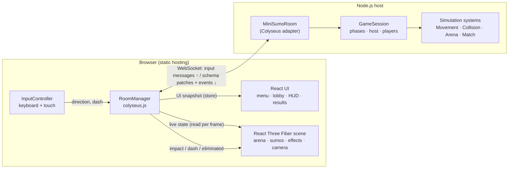

# Mini Sumo

A fast, cute, browser-based **3D** multiplayer party game. Two to four toy sumo wrestlers share a raised dohyo; push everyone else out of the ring and be the last one standing.

- **Client:** React 19 + React Three Fiber (three.js) + Vite, TypeScript
- **Server:** Colyseus 0.16 (authoritative rooms, matchmaking, schema state sync) on Node.js, TypeScript
- **Shared:** a small TypeScript package with constants, message names and state types

No accounts, downloads or installs: open the page, create or join a room, play.

> This project was originally specified for Phaser (2.5D). It is implemented with React Three Fiber in real 3D instead, as requested. Gameplay is still simulated on a flat 2D plane on the server; the client renders it in 3D.

---

## Screenshots

_Placeholders. No screenshots have been captured yet._

| Main menu | Lobby | Bout | Results |
| --- | --- | --- | --- |
| `docs/screenshots/menu.png` (todo) | `docs/screenshots/lobby.png` (todo) | `docs/screenshots/bout.png` (todo) | `docs/screenshots/results.png` (todo) |

---

## Features

Implemented:

- Quick match (public matchmaking via `joinOrCreate`), private rooms (`create` + `setPrivate`), join by room code or invite link (`?room=<roomId>`)
- Lobby with room code, copy/share invite link, roster with slot number + colour + host and "you" tags, host-only **Start match**
- Server-side phase machine: `waiting → lobby → countdown → playing → roundOver → lobby | countdown`
- Server-authoritative 3-2-1-GO countdown and 90 s bout timer
- Momentum-based movement (acceleration, speed cap, exponential drag), circular collisions with impulses and a push bonus, dash with 180 ms duration and 3 s cooldown (dashers count as heavier)
- Ring-out elimination from gameplay coordinates only, last-standing win, documented timeout tiebreaker and draws, final standings
- Rematch (host) or return to lobby; automatic return to the lobby 20 s after results
- Disconnect handling for every phase, host transfer, joins rejected during matches, empty rooms disposed by Colyseus
- Input validation, name sanitisation and per-client rate limiting (token bucket)
- 3D procedural low-poly art (no image assets in the 3D scene): sumo characters with squash-and-stretch, walk cycle, blinking, dash lean, ring-out fall and tumble, victory hop; dohyo with straw boundary, starting lines, corner tassel posts and cushions
- Effects: pooled dust particles, impact shockwave rings, camera shake on strong hits
- Game logo (transparent PNG/WebP) on the main menu, plus favicon, Apple touch icon and web app manifest icons in `apps/client/public/`
- Synthesised Web Audio sound effects (no files), mute toggle, unlocked on first gesture
- Keyboard (WASD/arrows, Space, Esc) and touch (virtual joystick + dash button with cooldown ring)
- Responsive camera that always fits the ring in portrait and landscape; safe-area aware UI
- 62 unit tests for movement, collision, arena, dash, match lifecycle, lobby/host/disconnect logic and validation

Not implemented (see [Known limitations](#known-limitations)): reconnection, ready-check, spectators joining mid-match, client-side prediction, accounts.

---

## Prerequisites

- **Node.js 20.12 or newer** (22 LTS recommended; `.nvmrc` is included)
- npm 10+

## Installation

```bash
git clone <your-repo-url> mini-sumo
cd mini-sumo
npm install
cp .env.example .env      # optional for local development
```

`package-lock.json` is not committed yet because the project was authored offline. Run `npm install` once and commit the generated lock file.

## Environment configuration

One `.env` file at the repository root serves both apps. Only variables prefixed with `VITE_` are exposed to the browser, and they are baked in at build time, so never put secrets there.

| Variable | Used by | Default | Purpose |
| --- | --- | --- | --- |
| `PORT` | server | `2567` | HTTP + WebSocket port |
| `HOST` | server | `0.0.0.0` | Bind address (`0.0.0.0` lets phones on your LAN connect) |
| `VITE_SERVER_URL` | client (build time) | empty | Public WebSocket endpoint, e.g. `wss://sumo-api.example.com`. **Set this in production.** |
| `VITE_SERVER_PORT` | client (build time) | `2567` | Port for the fallback URL when `VITE_SERVER_URL` is empty |
| `VITE_PUBLIC_URL` | client (build time) | empty | Public web address for invite links (needed by desktop/Android builds) |
| `VITE_BASE` | client (build time) | `/` | Base path, e.g. `/<repo>/` for GitHub Pages |

If `VITE_SERVER_URL` is empty, the client connects to `ws(s)://<page hostname>:<VITE_SERVER_PORT>`. That makes local and LAN development work with no configuration and never hard-codes `localhost`.

## Development

```bash
npm run dev          # builds shared, then runs shared (watch), server and client together
```

- Client: http://localhost:5173 (also on your LAN IP, printed by Vite)
- Server: ws://localhost:2567, health check at http://localhost:2567/health

Individual processes: `npm run dev:server`, `npm run dev:client`, `npm run dev:shared` (run `npm run build:shared` once first).

Play locally by opening two or more browser tabs: create a private room in one, copy the invite link into the others.

## Production build

```bash
npm run build        # shared → server (dist/) → client (apps/client/dist/)
npm start            # node apps/server/dist/index.js
npm run preview      # optional: serve the built client locally on :4173
```

## Tests and type checks

```bash
npm test             # vitest, server-side gameplay and room-logic tests
npm run typecheck    # tsc for server and client
```

---

## Architecture



```
mini-sumo/
├─ package.json              npm workspaces + root scripts
├─ tsconfig.base.json
├─ .env.example
├─ packages/shared/src/      constants, message names, synced state types, math helpers
├─ apps/server/
│  ├─ src/index.ts           HTTP server + Colyseus + room registration
│  ├─ src/rooms/MiniSumoRoom.ts   thin Colyseus adapter
│  ├─ src/state/MiniSumoState.ts  @colyseus/schema state
│  ├─ src/game/GameSession.ts     framework-free authoritative game (testable)
│  ├─ src/simulation/        SimulationConfig, SimBody, Movement, Collision, Arena, Match systems
│  ├─ src/validation/        InputValidator
│  └─ test/                  vitest suites
├─ apps/desktop/           Electron shell (main.cjs) + electron-builder config
├─ apps/mobile/            Capacitor config + Android icon/splash sources
├─ .github/workflows/build.yml   CI: test, web, desktop, Android, release
└─ apps/client/
   ├─ index.html, vite.config.ts
   └─ src/
      ├─ network/RoomManager.ts   connection, matchmaking, state → stores, events → effects/audio
      ├─ input/InputController.ts keyboard + touch → normalized direction
      ├─ game/                    GameCanvas, Arena, SumoModel, NetSumo, MenuSumos, Effects, CameraRig
      ├─ ui/                      MainMenu, Lobby, HUD, Countdown, Results, SettingsPanel, TouchControls, Toasts
      ├─ audio/AudioManager.ts    synthesized Web Audio effects
      └─ styles.css
```

Design decisions:

- **Simulation is framework-free.** `GameSession` and the systems operate on plain objects with an injected fixed-step clock. The Colyseus room only forwards messages, copies session data into the schema and broadcasts events. This is what makes the room logic unit-testable without a running server, and keeps a future engine or transport change cheap.
- **Rendering is separate from simulation.** Server coordinates are `(x, y)` metres on the ring floor; the client maps them to three.js `(x, 0, y)`. The 3D models, falls and effects are cosmetic and never feed back into gameplay.
- **React re-renders are rare.** The scene reads the live Colyseus state inside `useFrame`; React components only re-render from a low-frequency UI snapshot (phase, timer at 100 ms resolution, roster), compared by value before notifying.

## Multiplayer architecture

- **Authority:** the server owns membership, host, spawn positions, phases, timers, physics, dash cooldowns, eliminations, winners and rematches. Clients send only `input {x, y}` (direction), `dash`, `start`, `rematch` and `returnToLobby`. Positions, eliminations or winners sent by a client are not accepted by any handler.
- **Identity:** every message is attributed via the Colyseus `client.sessionId`; no client-supplied ids are trusted. Host checks compare against the server's `hostId`.
- **Tick:** fixed 30 Hz steps (`SimulationConfig.tickRate`) driven by `setSimulationInterval`, with an accumulator, a cap of 4 steps per update and a 250 ms clamp on real deltas after stalls. Patch rate is also ~30 Hz.
- **Synced state:** per player `sessionId, name, colorIndex, x, y, vx, vy, angle, alive, connected, dashing, dashCooldownMs, placement, elimReason`; per room `phase, phaseRemainingMs, hostId, winnerId, isDraw, round, maxPlayers, isPrivate, aliveCount, standings`. Particles, camera and animation are client-only.
- **Transient events** are Colyseus messages: `impact` (position + strength), `dash`, `eliminated`, `error`.
- **Smoothing:** the client exponentially interpolates each sumo toward the latest server position. There is **no client-side prediction**; your own wrestler responds after one round trip.
- **Validation:** inputs must be finite numbers; they are clamped to [-1, 1], normalised, and a deadzone is applied. Names are trimmed, stripped of control and bidi characters and limited to 16 characters. Each client has a token bucket (burst 30, 60 messages/s). Dash requests are checked for phase, alive state and cooldown.

## Room lifecycle

| Situation | Behaviour |
| --- | --- |
| Room created | `maxPlayers` clamped to 2–4. `private: true` calls `setPrivate(true)` so the room is hidden from quick match but joinable by id. |
| Join while waiting/lobby | Accepted until the room is full. Colours fill the lowest free slot. First player is host. |
| Join during countdown/match/results | Rejected with "A match is in progress…". The room is also `lock()`ed from countdown until it returns to the lobby. |
| Leave in waiting/lobby | Player removed. Phase re-evaluated (`lobby` needs 2+). |
| Leave during countdown | Player removed; countdown aborts to lobby/waiting if fewer than 2 remain. |
| Leave or disconnect during a bout | Player is eliminated with reason `left`, kept for standings, removed when the room returns to the lobby. If one player remains, they win. |
| Leave during results | Marked disconnected, removed on return to lobby or rematch. |
| Host leaves | Host moves to the earliest-joined connected player. |
| Everyone leaves | Colyseus auto-disposes the room. |
| Reconnection | **Not supported.** Any disconnect is final; rejoin with the invite link while the room is in its lobby. |

## Game rules

- 2–4 players per room; the host starts once at least 2 are present.
- 3 s countdown (wrestlers are frozen), then a 90 s bout.
- You're out when your centre passes **7.2 m** from the ring centre (ring radius 7 m + 0.2 m tolerance). The straw rope is drawn exactly at 7 m. Only gameplay coordinates count, never the 3D model.
- Within a tick the server runs: movement → collisions → ring-outs → last-standing check → timer check. So a ring-out on the final tick is counted before the timer.
- **Winner:** the last player in the ring.
- **Everyone out in the same tick:** draw; they share first place.
- **Time up with several players in the ring:** the one closest to the centre wins. If the two closest are within 5 cm of each other, it's a draw among all players that close.
- **Standings:** winner (or tied players) first, then players still in the ring by distance to centre, then eliminated players by elimination time (later is better; same tick shares a place).
- After results the host can start a **Rematch** or go **Back to lobby**. Otherwise the room returns to the lobby after 20 s.

Tuning lives in `apps/server/src/simulation/SimulationConfig.ts` (acceleration 28 m/s², max speed 6.5 m/s, drag 4/s, dash 11.5 m/s for 180 ms, cooldown 3 s, dash mass ×2.5, restitution 0.35, push bonus 5).

## Controls

| Action | Keyboard | Touch |
| --- | --- | --- |
| Move | WASD or arrow keys | Left joystick |
| Dash | Space | Dash button (fills as it recharges) |
| Settings | Esc | Gear button |

Settings never pause the shared match; while they are open your wrestler receives no input. Touch controls default to "Auto" (shown on touch devices) and can be forced on or off in settings.

---

## Deployment

The client is a static site; the server needs a long-running Node.js process with WebSocket support. Static hosting cannot run the server.

### 1. Server (any Node host: a VPS, Render, Railway, Fly.io, Colyseus Cloud…)

```bash
npm ci
npm run build:shared
npm run build -w @mini-sumo/server
PORT=2567 npm start
```

Put it behind HTTPS so browsers can use `wss://`. Example nginx block:

```nginx
server {
  listen 443 ssl;
  server_name sumo-api.example.com;
  # ssl_certificate ...; ssl_certificate_key ...;
  location / {
    proxy_pass http://127.0.0.1:2567;
    proxy_http_version 1.1;
    proxy_set_header Upgrade $http_upgrade;
    proxy_set_header Connection "upgrade";
    proxy_set_header Host $host;
    proxy_read_timeout 3600s;
  }
}
```

Colyseus uses HTTP for matchmaking (`/matchmake/*`, CORS handled by Colyseus) and WebSockets for the room, both on the same port. Run **one** server process: rooms live in memory, so multiple instances need Colyseus presence/driver (Redis), which this MVP does not configure.

### 2. Client (Netlify, Vercel, Cloudflare Pages, GitHub Pages, S3…)

```bash
VITE_SERVER_URL=wss://sumo-api.example.com npm run build
# upload apps/client/dist/
```

`VITE_SERVER_URL` is read at build time; rebuild when it changes. Pages served over `https://` must use a `wss://` server URL.

## CI builds: web, desktop and Android (GitHub Actions)

`.github/workflows/build.yml` runs on every push/PR to `main`, on tags `v*` and manually:

| Job | Runner | Output artifact |
| --- | --- | --- |
| Typecheck & test | ubuntu | (server tests, server build) |
| Web | ubuntu | `mini-sumo-web` (static site, built for `/<repo>/`); optional GitHub Pages deploy |
| Desktop | windows / macos / ubuntu | `.exe` installer + portable, `.dmg` (x64 + arm64), `.AppImage` + `.deb` |
| Android | ubuntu (JDK 21) | `MiniSumo-android-debug.apk`, plus signed release `.apk`/`.aab` if a keystore is configured |
| GitHub Release | ubuntu | on `v*` tags: everything above attached to a release |

Desktop is an **Electron** shell (`apps/desktop`) that serves the built client from `http://127.0.0.1:41730`. Android is a **Capacitor** shell (`apps/mobile`); the native project is generated in CI (`cap add android`), so `apps/mobile/android/` is not committed. Icons and splash come from `apps/desktop/build/icon.png` and `apps/mobile/assets/`.

**The apps are clients only.** The Colyseus server still has to run somewhere (see [Deployment](#deployment)). Configure the repository under *Settings → Secrets and variables → Actions*:

| Name | Kind | Required | Purpose |
| --- | --- | --- | --- |
| `VITE_SERVER_URL` | variable | yes | Public server, e.g. `wss://sumo-api.example.com`. Android requires `wss://`. |
| `VITE_PUBLIC_URL` | variable | no | Web address used in invite links from the apps. Defaults to `https://<owner>.github.io/<repo>/`. |
| `DEPLOY_PAGES` | variable | no | `true` to publish the web build to GitHub Pages from `main` (also set *Settings → Pages → Source: GitHub Actions*). |
| `ANDROID_KEYSTORE_BASE64` | secret | no | `base64 -w0 release.keystore` |
| `ANDROID_KEYSTORE_PASSWORD`, `ANDROID_KEY_ALIAS`, `ANDROID_KEY_PASSWORD` | secrets | no | Keystore credentials |

Create a release: `git tag v1.0.0 && git push origin v1.0.0`. The tag sets the desktop version and Android `versionName`; the Android `versionCode` is the workflow run number.

Notes:
- Desktop builds are **unsigned**. Windows SmartScreen shows a warning ("More info → Run anyway"); on macOS right-click the app and choose *Open*, or run `xattr -dr com.apple.quarantine "/Applications/Mini Sumo.app"`.
- The debug APK installs directly on a phone (allow "install unknown apps"). Use the signed AAB for Google Play.

Local equivalents:

```bash
npm run desktop          # build web + launch Electron
npm run build:desktop    # build web + package for the current OS (apps/desktop/release/)
cd apps/mobile && npx cap add android   # once; needs Android Studio / SDK + JDK 21
npm run build:android    # build web + cap sync; then: npm run android:open -w @mini-sumo/mobile
```

## Troubleshooting

- **"Can't reach the game server at …"**: the server is not running, the port is blocked, or `VITE_SERVER_URL` is wrong. Open `http(s)://<server>/health`; it should return `{"ok":true}`.
- **Works on desktop, not on phone (LAN):** open the client using your computer's LAN IP (Vite prints it), make sure the server binds `HOST=0.0.0.0`, and allow port 2567 in the firewall.
- **Mixed content / WebSocket blocked in production:** an `https` page cannot open `ws://`. Use `wss://` behind TLS.
- **"That room doesn't exist anymore":** rooms are disposed once empty, and codes are case-sensitive. Use the invite link.
- **"That room is full or a match is already running":** wait for the round to end, or create a new room.
- **`process.loadEnvFile is not a function`:** upgrade to Node.js 20.12+.
- **Decorator or schema errors on the server:** `experimentalDecorators: true` and `useDefineForClassFields: false` must stay in `apps/server/tsconfig.json`.

## Known limitations

- No reconnection: a dropped connection ends your participation in the room.
- No client-side prediction; on high-latency links your own movement feels delayed.
- Single server instance; no horizontal scaling configuration.
- No ready-check, spectator joining, accounts, or persistent stats.
- Room codes are the Colyseus room ids (about 9 case-sensitive characters). Privacy means "not listed"; anyone with the code can join. It is not an authorization mechanism.
- No automated Colyseus integration tests (`@colyseus/testing`); room logic is tested through `GameSession`, which the room delegates to.
- Name tags use a canvas texture; they redraw once the web font loads, and fall back to system rounded fonts offline.
- Google Fonts is loaded from the network; the game works without it using fallback fonts.
- Colyseus 0.16 is used deliberately (stable, well known APIs). Newer 0.17/0.18 releases rename the client SDK (`@colyseus/sdk`) and change server bootstrapping; upgrade following the official migration guides.
