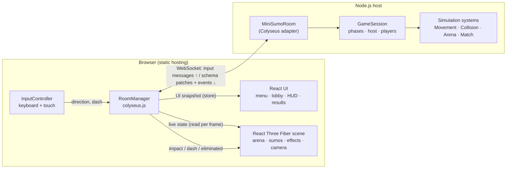

# Mini Sumo architecture

Technical notes for contributors. For playing and building, see the [README](../README.md).

## Architecture



```
mini-sumo/
├─ package.json              npm workspaces + root scripts
├─ tsconfig.base.json
├─ .env.example
├─ packages/shared/src/      constants, message names, synced state types, math helpers
├─ apps/server/
│  ├─ src/index.ts           HTTP server + Colyseus + room registration
│  ├─ src/rooms/MiniSumoRoom.ts   thin Colyseus adapter
│  ├─ src/state/MiniSumoState.ts  @colyseus/schema state
│  ├─ src/game/GameSession.ts     framework-free authoritative game (testable)
│  ├─ src/simulation/        SimulationConfig, SimBody, Movement, Collision, Arena, Match systems
│  ├─ src/validation/        InputValidator
│  └─ test/                  vitest suites
├─ apps/desktop/           Electron shell (main.cjs) + electron-builder config
├─ apps/mobile/            Capacitor config + Android icon/splash sources
├─ .github/workflows/build.yml   CI: test, web, desktop, Android, release
└─ apps/client/
   ├─ index.html, vite.config.ts
   └─ src/
      ├─ network/RoomManager.ts   connection, matchmaking, state → stores, events → effects/audio
      ├─ input/InputController.ts keyboard + touch → normalized direction
      ├─ game/                    GameCanvas, Arena, SumoModel, NetSumo, MenuSumos, Effects, CameraRig
      ├─ ui/                      MainMenu, Lobby, HUD, Countdown, Results, SettingsPanel, TouchControls, Toasts
      ├─ audio/AudioManager.ts    synthesized Web Audio effects
      └─ styles.css
```

Design decisions:

- **Simulation is framework-free.** `GameSession` and the systems operate on plain objects with an injected fixed-step clock. The Colyseus room only forwards messages, copies session data into the schema and broadcasts events. This is what makes the room logic unit-testable without a running server, and keeps a future engine or transport change cheap.
- **Rendering is separate from simulation.** Server coordinates are `(x, y)` metres on the ring floor; the client maps them to three.js `(x, 0, y)`. The 3D models, falls and effects are cosmetic and never feed back into gameplay.
- **React re-renders are rare.** The scene reads the live Colyseus state inside `useFrame`; React components only re-render from a low-frequency UI snapshot (phase, timer at 100 ms resolution, roster), compared by value before notifying.

## Multiplayer architecture

- **Authority:** the server owns membership, host, spawn positions, phases, timers, physics, dash cooldowns, eliminations, winners and rematches. Clients send only `input {x, y}` (direction), `dash`, `start`, `rematch` and `returnToLobby`. Positions, eliminations or winners sent by a client are not accepted by any handler.
- **Identity:** every message is attributed via the Colyseus `client.sessionId`; no client-supplied ids are trusted. Host checks compare against the server's `hostId`.
- **Tick:** fixed 30 Hz steps (`SimulationConfig.tickRate`) driven by `setSimulationInterval`, with an accumulator, a cap of 4 steps per update and a 250 ms clamp on real deltas after stalls. Patch rate is also ~30 Hz.
- **Synced state:** per player `sessionId, name, colorIndex, x, y, vx, vy, angle, alive, connected, dashing, dashCooldownMs, placement, elimReason, isBot, hair, hairColor, face, outfit`; per room `phase, phaseRemainingMs, hostId, winnerId, isDraw, round, maxPlayers, isPrivate, aliveCount, standings`. Particles, camera and animation are client-only.
- **Transient events** are Colyseus messages: `impact` (position + strength), `dash`, `eliminated`, `error`.
- **Smoothing:** the client exponentially interpolates each sumo toward the latest server position. There is **no client-side prediction**; your own wrestler responds after one round trip.
- **Validation:** inputs must be finite numbers; they are clamped to [-1, 1], normalised, and a deadzone is applied. Names are trimmed, stripped of control and bidi characters and limited to 16 characters. Each client has a token bucket (burst 30, 60 messages/s). Dash requests are checked for phase, alive state and cooldown.

## Room lifecycle

| Situation | Behaviour |
| --- | --- |
| Room created | `maxPlayers` clamped to 2–4. `private: true` calls `setPrivate(true)` so the room is hidden from quick match but joinable by id. |
| Join while waiting/lobby | Accepted until the room is full. Colours fill the lowest free slot. First player is host. |
| Join during countdown/match/results | Rejected with "A match is in progress…". The room is also `lock()`ed from countdown until it returns to the lobby. |
| Leave in waiting/lobby | Player removed. Phase re-evaluated (`lobby` needs 2+). |
| Leave during countdown | Player removed; countdown aborts to lobby/waiting if fewer than 2 remain. |
| Leave or disconnect during a bout | Player is eliminated with reason `left`, kept for standings, removed when the room returns to the lobby. If one player remains, they win. |
| Leave during results | Marked disconnected, removed on return to lobby or rematch. |
| Host leaves | Host moves to the earliest-joined connected player. |
| Everyone leaves | Colyseus auto-disposes the room. |
| Quick match (public room) | A lone player waits up to 30 s (`quickMatchWaitMs`). If no other human joins, bots join one by one (`botJoinIntervalMs`) at their ring-side slots, and the host starts the bout (the client unlocks the Start button one second later). The countdown begins with a walk-in (`entranceMs`, 1.6 s) from the ring-side slots to the start marks, then the 3-2-1. A ring-out is credited to the last wrestler in contact within `ringOutCreditMs` (2.5 s); the `eliminated` event carries `by`. A second human joining cancels the wait. On *Rematch* the bots stay; on returning to the lobby they are removed and the wait starts again. |
| Bots in private rooms | The host adds or removes bots in the lobby (`addBot`, `removeBot { id }`). Bots count toward the player limit and can never be host. |
| Reconnection | **Not supported.** Any disconnect is final; rejoin with the invite link while the room is in its lobby. |

## Bots

Bots live entirely on the server (`apps/server/src/game/BotBrain.ts`). Every 120–280 ms of simulation time a bot picks a direction and, sometimes, a dash. That input is applied exactly like validated human input and runs through the same `stepMovement`, collision and dash rules, so bots can't do anything a human can't.

- Target choice: the opponent that is close and near the edge.
- Approach from the centre side, then charge outward through the target; dash when close and aligned.
- Edge safety: the closer a bot is to the rope (from 72 % of the radius), the more it steers back.
- Random noise, the reaction delay and an input scale keep it beatable. Three levels (`BOT_TUNING` in `BotBrain.ts`):

| Level | Reaction | Steering noise | Dash chance | Input |
| --- | --- | --- | --- | --- |
| Easy | 240–440 ms | ±0.48 rad | 15 % | 72 % |
| Normal | 140–300 ms | ±0.25 rad | 35 % | 90 % |
| Hard | 90–180 ms | ±0.11 rad | 55 % | 100 % |

The level comes from the join options (`botLevel`), is fixed per room, and training matchmaking is filtered by it.

**Final stretch** (`lateGameMs`, last 30 s): human dash cooldown ramps from 3 s down to `lateDashCooldownFactor` (55 %), and bots ease off (`easedTuning`: slower reactions, up to 30 % weaker input, 60 % fewer dashes). Bots keep the normal cooldown. In simulations of an average player against three bots this gives roughly 70 % / 45 % / 30 % wins on Easy / Normal / Hard.

Quick-match bots get ordinary names (`botNames.ts`) and ids shaped like Colyseus session ids, and `isBot` is never sent for quick-match rooms, so they look like everyone else. In private rooms `isBot` is synced so the host can manage them.

## Character customisation

The look is four small indexes (`hair`, `hairColor`, `face`, `outfit`) defined in `packages/shared/src/appearance.ts`. The client saves them in settings, sends them in the join options and with `setAppearance` while in the lobby. The server validates every field with `sanitizeAppearance` (out-of-range values fall back to the default), only accepts changes in `waiting`/`lobby`, and syncs them per player. The belt colour is never customisable: it is the slot colour, which keeps players identifiable together with the P1–P4 number.

## Offline mode

`apps/server/src/sim.ts` exports the framework-free parts of the server (`GameSession`, config, helpers). The web client imports them through the `@mini-sumo/sim` alias (Vite `resolve.alias` + TypeScript `paths`), so offline mode runs the exact same rules as the server instead of a separate client-side copy.

`apps/client/src/network/connection.ts` defines `GameConnection`, the small surface `RoomManager` uses (`send`, `onStateChange`, `onMessage`, `leave`, live `state`). Two implementations:

- `wrapColyseusRoom(room)`: the online Colyseus room.
- `LocalConnection`: a `GameSession` ticking at 30 Hz in the browser, mirroring `MiniSumoRoom.syncState` into a plain object with the `SyncedState` shape and emitting the same `impact`/`dash`/`eliminated`/`error` messages. Offline quick match uses a 4 s search before bots fill the ring.

`networkMode.ts` decides the mode (`VITE_NETWORK_MODE`, missing `VITE_SERVER_URL` in production, or a `/health` probe), and `RoomManager` falls back to a `LocalConnection` when joining fails because the server is unreachable.

## Economy

See [ECONOMY.md](ECONOMY.md). In short: `apps/server/src/economy/` (config, `Economy` service on `node:sqlite`, prize formula, disabled payments, events), `apps/server/src/http/api.ts` (JSON API on the game port), and hooks in `MiniSumoRoom` (`onAuth` resolves the guest token; paid joins reserve the entry; `playing` locks entries; `roundOver` settles and records rewards; cancel/dispose refund). `GameSession` gained a `paidArena` mode (humans only, automatic start, cancel when alone, single round). The client side is `apps/client/src/network/economyClient.ts` plus the arena, wallet, wardrobe-shop and results UI.


## Power-ups

Handled in `GameSession` (authoritative, so the same online and offline):

- A flag (`session.item`) appears `powerUpFirstMs` (8 s) after the start, then every 8–12 s, at a random spot within 60 % of the ring radius and away from the wrestlers. It disappears after 8 s if nobody takes it, and no new flags appear in the final stretch.
- Touching it (`playerRadius × size + 0.55`) gives that power-up for `powerUpDurationMs` (12 s); a new one replaces the old. Pushed-out players lose theirs.
- Effects are applied through body modifiers (`massScale`, `radiusScale`, `speedScale` on `SimBody`) used by the movement and collision systems, plus a shorter dash cooldown for Thunder.
- Bots steer for the flag only after `botItemDelayMs[level]`, so players get the first chance.
- Synced as `powerUp` / `powerUpMs` per player and `itemKind` / `itemX` / `itemY` on the room. The client draws the flag on the ring and a banner on the wrestler's back (`PowerUpFlags.tsx`) and plays the power-up sounds for your own pickups.


## Profile: on the device first, synced with the server

Name, picture/look, XP, level and play stats always work on the device (settings and the
local wallet in localStorage), with or without a server.

- When the server is reachable (at start, or when it comes back: the client re-checks
  `/health` every 20 s between bouts), the device's copy is sent to `POST /api/profile/sync`.
- Merge rules (`Economy.syncProfile`): name and look, the newer side wins (by the time they
  were last changed; a clock far in the future is ignored; only owned items); XP, matches and
  wins, the higher value wins, so progress made offline is never lost. Synced XP grants no
  coins (level-up coins only come from bouts played on the server).
- While online, every profile the server sends is merged back into the device's copy, so the
  game can carry on offline at any time. If the server goes away between bouts, the game
  switches to the device and keeps going.
- While waiting for the server (the start-up check, or joining an online room) the client
  shows the running-sumo screen (`ui/ServerWait.tsx`).


## Friends and game invites

Server (`apps/server/src/social/Friends.ts`, tables `friend_codes` and `friendships` in the
economy database; presence and invites in memory):

- Every account gets a 6-character friend code. Adding a code sends a request; the other
  player accepts or declines. If both add each other, they become friends right away.
- Online = the game called the API in the last minute (the open game checks for invites
  every 8 s, which keeps it marked online).
- Invites: `POST /api/invites { accountId, roomId }` (friends who are online only); the
  friend's game shows a "Join / Not now" popup and joins the room by id. Invites expire after
  two minutes; one live invite per friend.

Client: `ui/FriendsPanel.tsx` (code, add, requests, list with online dots, Play),
`ui/FriendProfilePopup.tsx` (picture, level, bouts, wins, Play, Remove),
`ui/InviteWatcher.tsx` (invite popups, never mid-bout) and the "Invite friends" list in the
waiting room. "Play" from the list opens a private room and invites that friend.
Friends need the server; offline the panel says so.
